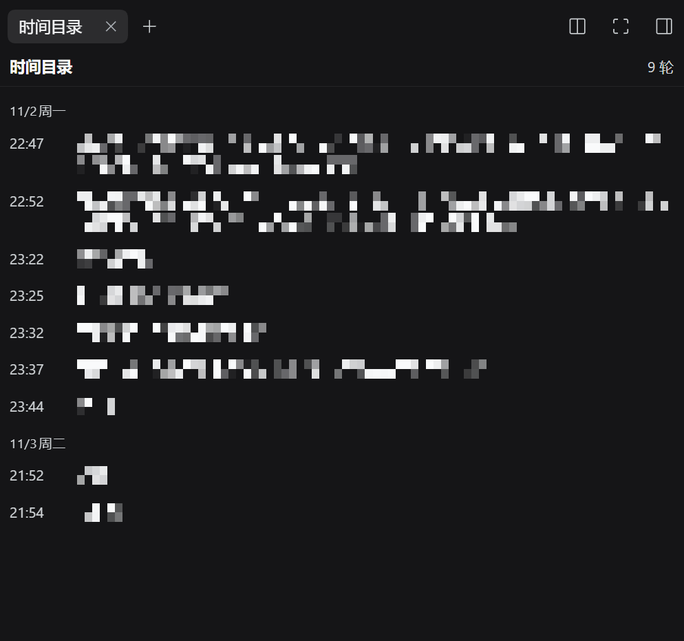
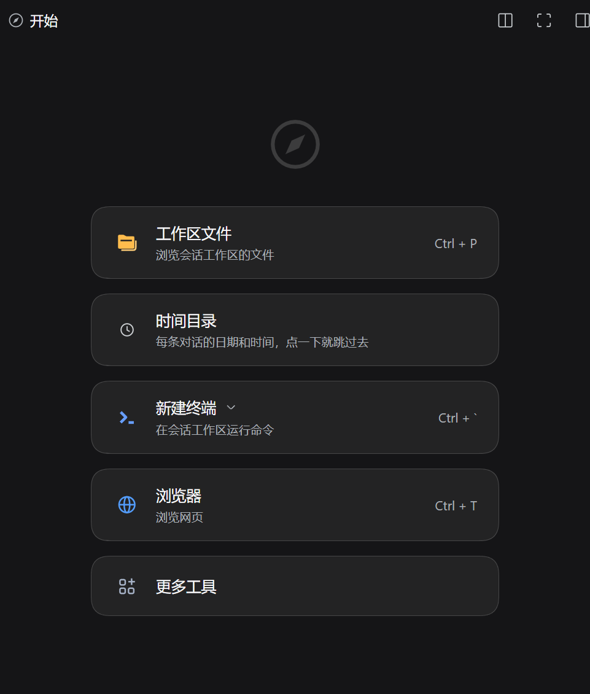

# dsh-turn-clock

English | [中文](README.zh.md)

A right-sidebar tab for DeepSeek Harness that lists **every turn of the current session with the date and time it started**, and jumps the conversation to the turn you click.



<sub>Prompt text is mosaicked so a real conversation stays private; the dates, times and layout are unedited.</sub>

## Why

DSH already has a turn rail on the right edge of the conversation, and it is good: it lists turns, previews them, and jumps. Two things it does not do:

- **It carries no time.** The `turnOutline` projection it renders has only `turn / seq / prompt / response`, so there is nothing to date a turn with.
- **It disappears when the transcript is narrow.** The rail is not rendered at all when the transcript's available width is ≤ 900 px — which is exactly when you open a sidebar.

This plugin is the second surface for the same question: a real page in the right Sidebar, grouped by calendar day, one row per turn, each row showing `HH:mm` plus the start of that turn's prompt. Click a row to go there.

## How this compares

Turn navigation is a crowded corner of the DSH plugin ecosystem. Being precise about what differs is more useful than claiming novelty:

| | Surface | Dates/times | Depends on |
|---|---|---|---|
| **dsh-turn-clock** (this) | A tab in the **official right Sidebar** | Per-turn date + `HH:mm`, grouped by day, from the whole log | Nothing beyond DSH itself |
| Built-in turn rail | Strip on the conversation's right edge | None | — (but hidden when the transcript is ≤ 900 px wide) |
| [dsh-conversation-timeline](https://github.com/bycall/dsh-conversation-timeline) | Horizontal dock above the composer | Turn start time on each capsule | Nothing |
| [dsh-turn-outline](https://github.com/Andor-Z/dsh-turn-outline) | Right-sidebar tab | None (folds input + tool steps + output) | Peer `dsh-better-sidebar` |
| [dsh-timeline](https://github.com/houyanchao/dsh-timeline) | Axis on the conversation's right edge | None advertised | Nothing (much larger: pins, favourites, prompt library, export) |

The one-line version: **a dated outline in the official right sidebar, with no other plugin required.**

## Features

| Feature | Detail |
|---|---|
| Dated outline | One row per turn, grouped under `11月2日 周日`-style day headers, newest last |
| Click to jump | Pages history in through the turn's `turn/start` seq, then scrolls the turn's transcript row into view |
| Whole-log coverage | Times come from a Host projection folded over the **entire** session log, so turns the browser never loaded are still listed |
| Keyboard | Rows are focusable; `Enter` and `Space` jump |
| Locale | Chinese and English copy, following the app locale |
| No other plugin needed | Uses the official right Sidebar — no `dsh-better-sidebar` peer |

## Install

```sh
dsh plugin --profile web add github:saltedfish-T/dsh-turn-clock
```

Then restart DSH (or refresh the page). From a local checkout:

```sh
dsh plugin --profile web add file:/path/to/dsh-turn-clock
```

Built and tested against DSH `0.2.1-rc.5`. The plugin uses documented extension seams plus two internal contracts listed below, so a future DSH release can break the jump (see *What this depends on*).

## Use

Open the right Sidebar → **Start (指南 / Guide)** → the **Turn timeline (时间目录)** card. The first turn of a session is the top row; the list opens scrolled to the newest turn.



<sub>Where it lives: the guide's card list, one card among the shipped tools.</sub>

## How it works

**Host half** ([index.js](index.js)) registers one `turnClock` projection unit on `ctx.sessionProjections`:

- `turn/start` appends `{ turn, t: event.time, s: event.seq, p: '' }`
- the first human `user/message` of that turn fills `p` with a 120-character preview (injected context and tool results are excluded by checking `source.kind === 'user'`)
- `wire.view` returns the state object itself, so an unchanged fold publishes nothing

**Client half** ([client.js](client.js)):

- registers a tab type through `ctx.sidebarRightTabs.register()` and its body under the keyed `sidebar.right.pane.tab` slot, plus a guide entry
- reads the projection with the standard `useProjection('turnClock')` keyed hook
- jumps with `ctx.sessions.binding(sessionId).session.loadThrough(seq)`, then `scrollIntoView` on the transcript row

## What this depends on

This is a third-party plugin, not a first-party seam. Two internals are load-bearing, and both are named here on purpose:

1. **`data-chat-turn="<n>"`** — Chat puts the turn number on every transcript row. The jump finds its target with this attribute. Chat uses the same attribute for its own reading-position tracking.
2. **`binding.session.loadThrough(seq)`** — the jump loader Chat's own rail calls when a turn is not loaded yet. Accessed through `ctx.sessions.binding(sessionId)`.

If either changes upstream:

- **Times and the list keep working** — they only depend on the projection seam and the slot system.
- **The jump degrades gracefully** — the panel shows a one-line reason at its foot instead of throwing.

A `turnOutline` projection is read as a fallback source of per-turn seqs, so a jump still works when this package's own projection predates a field.

## Known limitations

- **Turns removed by compaction cannot be jumped to.** Once a turn is no longer part of the session surface it has no row in the DOM; the row stays listed (the projection still knows it started) but clicking it reports that it could not be found. The built-in rail has the same limit.
- **Centered, not top-aligned.** The jump centers the turn; Chat's own rail aligns it 24 px below the top edge.
- **No view switching.** If you are in the Trajectory view rather than Chat, there are no transcript rows to scroll; the panel says so instead of switching views for you.
- **Day labels follow the browser locale** via `Intl.DateTimeFormat`, which is usually but not always the app locale.
- **Timestamps are turn starts.** The time is the `turn/start` event, i.e. the moment the loop began the turn right after your prompt — not when a message first painted.

## Development

No build step: the client half is hand-written in the `window.__ModuleLoader__.load({ id, factory })` format and depends on nothing but `react` from the module table.

```sh
node --check index.js
node --check client.js
node test/fold.test.mjs      # drives the projection fold with synthetic events
```

`test/fold.test.mjs` covers the time/seq anchoring, whitespace normalization, injected-context exclusion, same-turn second messages, stale turn boundaries, and the preview budget.

**Working on this repository as an agent?** Read [AGENTS.md](AGENTS.md) first: it carries the install and verification checklist, what each failure string in the panel means, and how to re-check the two internal contracts against a newer DSH release.

## Uninstall

```sh
dsh plugin --profile web remove dsh-turn-clock
```

## License

MIT — see [LICENSE](LICENSE).
