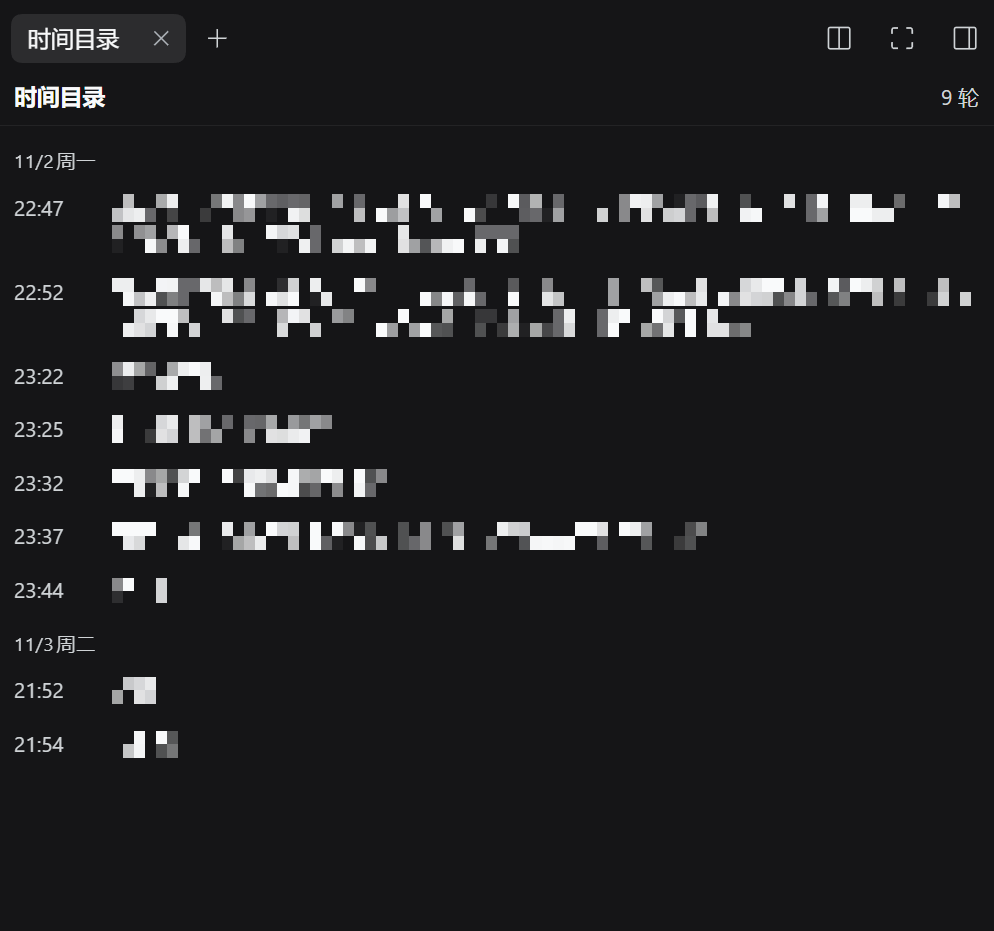
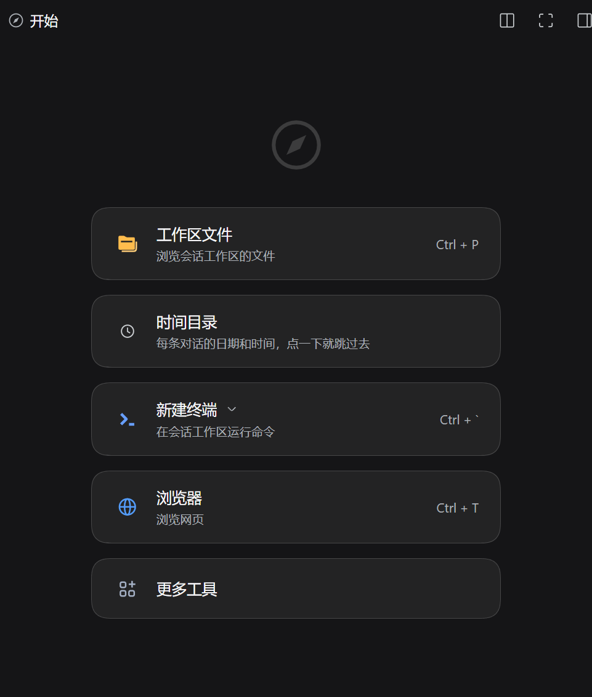

# dsh-turn-clock

[English](README.md) | 中文

给 DeepSeek Harness 的右侧栏加一个标签页：把这个会话**每一轮的日期和开始时间**按顺序列出来，点一下就跳到对话里的那一轮。



<sub>提示词内容已打码，日期、时间与布局都是原样未改的。</sub>

## 为什么

DSH 已经有一条对话右侧的轮次刻度条了，它挺好用：列出轮次、悬停给预览、点击跳转。但它缺两样：

- **没有时间。** 它渲染的 `turnOutline` 投影只有 `turn / seq / prompt / response`，没有任何可以标日期的字段。
- **会话变窄就消失。** 会话可用宽度 ≤ 900px 时整条 rail 根本不渲染 —— 而你打开侧边栏，正好就是这个时候。

这个插件是同一个问题的第二个表面：右侧栏里的一个真页面，按日历分组，一轮一行，每行是 `HH:mm` 加这一轮提示词的开头。点一行，就过去。

## 和同类插件的区别

轮次导航在 DSH 插件生态里已经很挤了。把差异讲准，比声称"首创"有用：

| | 位置 | 日期 / 时间 | 依赖 |
|---|---|---|---|
| **dsh-turn-clock**（本插件） | **官方右侧栏**的标签页 | 每轮日期 + `HH:mm`，按天分组，来自完整日志 | 除 DSH 本身外无依赖 |
| 内置轮次 rail | 对话右侧边缘的刻度条 | 无 | —（但会话宽度 ≤ 900px 时不渲染） |
| [dsh-conversation-timeline](https://github.com/bycall/dsh-conversation-timeline) | 输入框上方的横向 dock 条 | 每个胶囊带轮次开始时间 | 无 |
| [dsh-turn-outline](https://github.com/Andor-Z/dsh-turn-outline) | 右侧栏标签页 | 无（折叠输入 + 工具步骤 + 输出） | peer 依赖 `dsh-better-sidebar` |
| [dsh-timeline](https://github.com/houyanchao/dsh-timeline) | 对话右侧边缘的轴条 | 未提及 | 无（体量大得多：图钉、收藏、提示词库、导出） |

一句话定位：**官方右侧栏里的带日期目录，不依赖任何其它插件。**

## 功能

| 能力 | 说明 |
|---|---|
| 带日期的目录 | 一轮一行，按 `11月2日 周日` 这样的日期分节，最新在底部 |
| 点击跳转 | 先用这一轮的 `turn/start` seq 把历史翻进来，再把它在对话里的那一行滚到视野中 |
| 覆盖整条日志 | 时间来自 Host 侧对**完整** session log 的折叠投影，浏览器从没加载过的轮次也在列表里 |
| 键盘可用 | 行可聚焦，`Enter` / 空格跳转 |
| 中英双语 | 跟随应用语言 |
| 不依赖别的插件 | 用的是官方右侧栏，不需要 `dsh-better-sidebar` |

## 安装

```sh
dsh plugin --profile web add github:saltedfish-T/dsh-turn-clock
```

装完重启 DSH（或刷新页面）。本地目录安装：

```sh
dsh plugin --profile web add file:/path/to/dsh-turn-clock
```

开发和验证基于 DSH `0.2.1-rc.5`。插件用的是官方扩展位 + 下面列出的两处内部契约，所以将来 DSH 升级有可能打断跳转（见「依赖了什么」）。

## 使用

打开右侧栏 → **指南 / Start** → 找到 **时间目录 / Turn timeline** 卡片。第一轮在最上面，打开时自动滚到最新的那一轮。



<sub>入口位置：指南的卡片列表里，和官方工具并排。</sub>

## 它怎么工作

**Host 半**（[index.js](index.js)）在 `ctx.sessionProjections` 上注册一个 `turnClock` 投影单元：

- `turn/start` 追加 `{ turn, t: event.time, s: event.seq, p: '' }`
- 这一轮第一条真人 `user/message` 填 `p`，截 120 字（靠 `source.kind === 'user'` 排除注入的上下文和工具结果）
- `wire.view` 直接返回状态对象本身，所以没有变化时不会产生发布

**Client 半**（[client.js](client.js)）：

- 用 `ctx.sidebarRightTabs.register()` 注册一个 tab 类型，body 注册到 keyed 的 `sidebar.right.pane.tab` 扩展位，并给指南提供一张卡片
- 用标准的 `useProjection('turnClock')` 键控 hook 读投影
- 跳转用 `ctx.sessions.binding(sessionId).session.loadThrough(seq)`，然后对那一行 `scrollIntoView`

## 依赖了什么

这是第三方插件，不是官方扩展位。有两处内部实现是承重的，这里**故意写明**：

1. **`data-chat-turn="<n>"`** —— Chat 给每条对话行打上的轮次号。跳转靠这个属性找目标行；Chat 自己的阅读位置追踪也用同一个属性。
2. **`binding.session.loadThrough(seq)`** —— Chat 自己的 rail 跳转时调用的历史加载器，通过 `ctx.sessions.binding(sessionId)` 拿到。

如果上游改了其中任何一处：

- **时间和列表照常工作** —— 它们只依赖投影扩展位和插槽系统。
- **跳转会优雅降级** —— 面板底部给一句原因，而不是抛异常。

另外会读取 `turnOutline` 投影作为每轮 seq 的兜底来源，所以即使本插件的投影缺字段，跳转也照样能用。

## 已知限制

- **被压缩掉的轮次跳不过去。** 一旦某一轮退出了对话表面，它在 DOM 里就没有行了；列表里还会列出它（投影知道它开始过），但点击会告诉你找不到。内置 rail 同样如此。
- **居中对齐，不是顶部对齐。** 跳转把目标轮居中显示；Chat 自己的 rail 是距顶部 24px 对齐。
- **不切视图。** 如果你当前在「轨迹」而不是「对话」视图，就根本没有可滚的对话行；面板会说明这一点，不会替你切视图。
- **日期标题跟随浏览器语言**（`Intl.DateTimeFormat`），通常但不总是等于应用语言。
- **时间取的是轮次开始。** 具体是 `turn/start` 事件的时刻，也就是你发完提示词、agent loop 开始这一轮的瞬间，不是消息出现在屏幕上的时刻。

## 开发

没有构建步骤：客户端半天是手写的 `window.__ModuleLoader__.load({ id, factory })` 格式，除了模块表里的 `react` 之外不依赖任何东西。

```sh
node --check index.js
node --check client.js
node test/fold.test.mjs      # 用合成事件驱动投影折叠
```

`test/fold.test.mjs` 覆盖了时间与 seq 的锚定、空白归一化、注入上下文不泄漏、同轮第二条消息、过期轮次边界、以及预览长度预算。

## 卸载

```sh
dsh plugin --profile web remove dsh-turn-clock
```

## 许可证

MIT，见 [LICENSE](LICENSE)。
